

<picture>
  <source media="(prefers-color-scheme: light)" srcset="assets/brand-light.png">
  
</picture>

**Your network. One clear view.**

A self-hosted network workspace for mixed-vendor equipment, 
with live telemetry, visual topology and AI-assisted investigation.

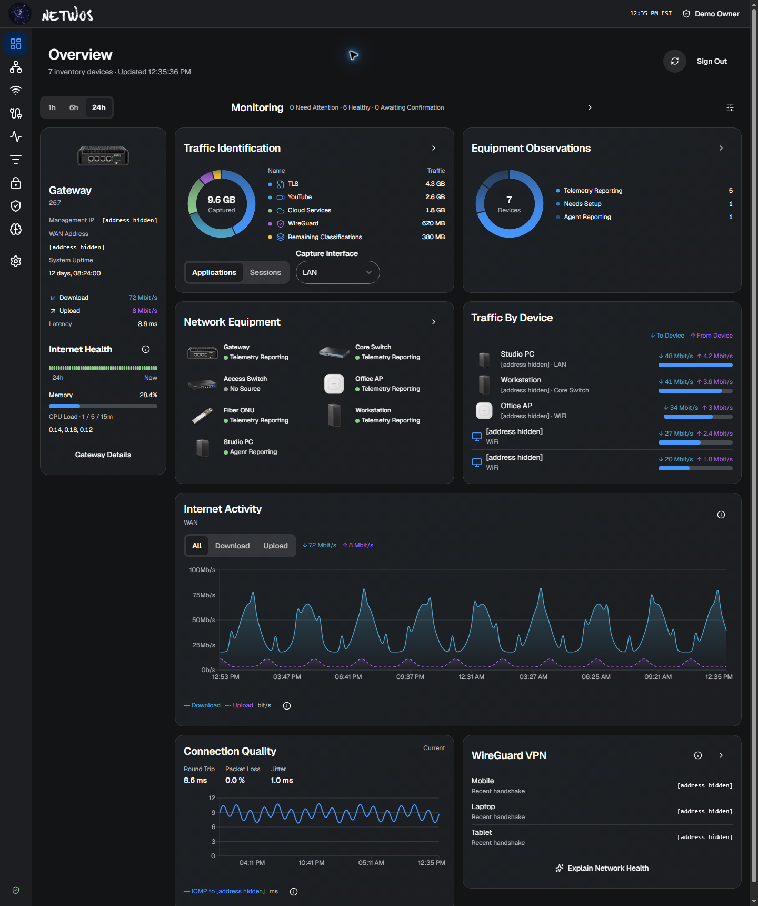

Actual interface, fictional demonstration network. Addresses are hidden in every capture.

## See what matters

Internet health, traffic, equipment and VPN activity share a compact workspace. Select a device or observation to investigate its own evidence, with clear handling of stale, partial and unavailable measurements.

| Traffic Identification | Internet Activity |
| --- | --- |
| 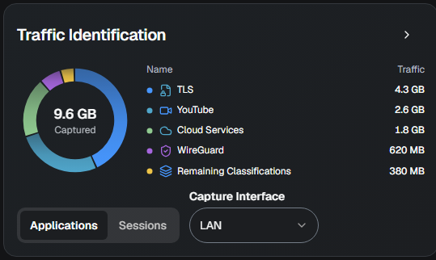 | 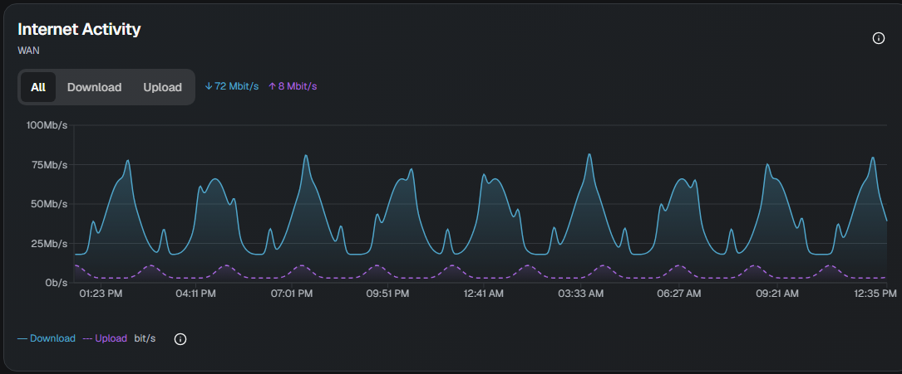 |
| Application classifications from a supported traffic source. | Distinct download and upload traces, shared time ranges and measurement details. |

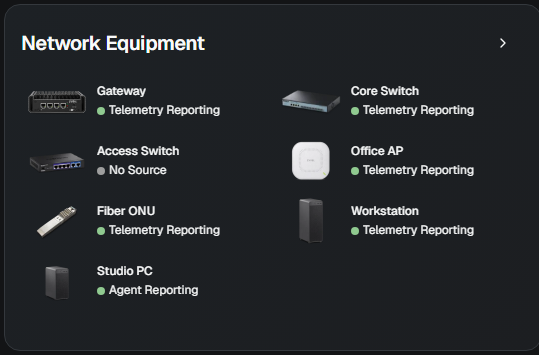

## Follow the connections

Clickable topology combines device observations and documented connections. Restrained flow animation reflects sampled traffic. Device details, history and evidence remain one selection away.

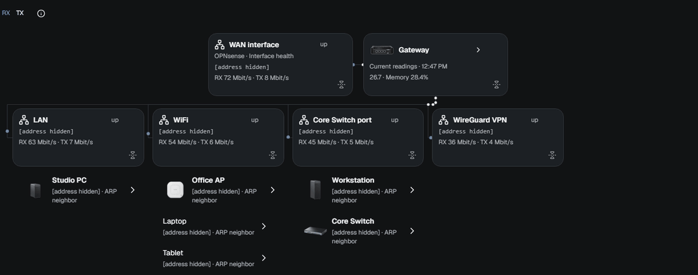

| Equipment Inventory | WiFi Dashboard |
| --- | --- |
| 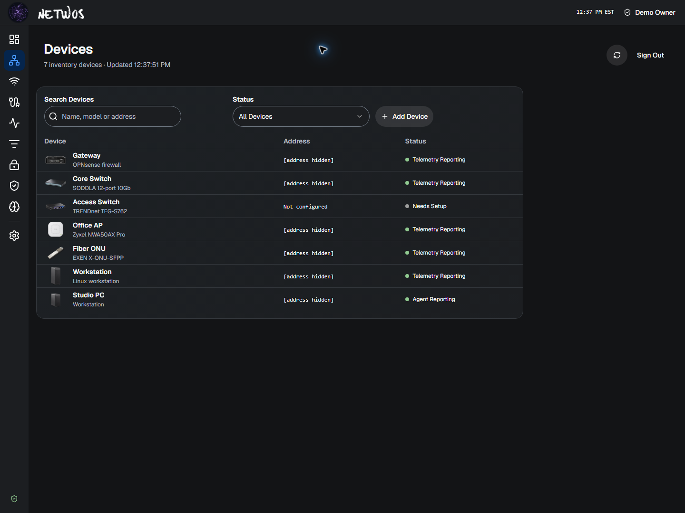 | 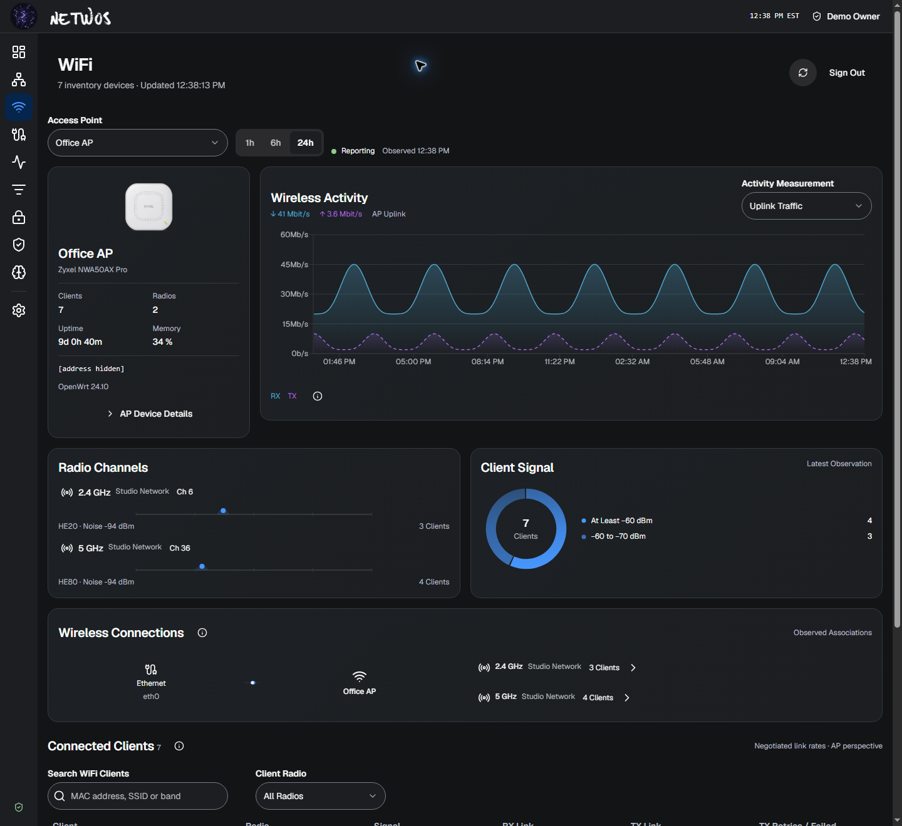 |
| Device profiles, editable connection details, firmware or OS, and dedicated health pages. | Supported AP radios, client associations, signal and traffic history. |

## Watch your VPN

WireGuard interface and peer observations, handshake age and separate received/sent traffic are available through supported gateway telemetry.

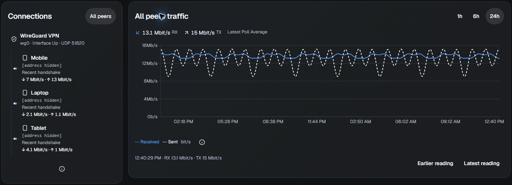

## An AI engineer with evidence

Choose the whole network or an enrolled device. Inspect the sanitized evidence before sending it to your selected provider. Reviews explain observed health, distinguish hypotheses from facts, and link findings to their source records and timestamps.

- Multiple provider profiles, with model selection and a custom endpoint option.
- Device credentials and provider keys stay separate and encrypted on the collector.
- Local context preview before an explicit review request.
- Configuration and firewall-rule investigation, retained reviews and exact proposal previews.

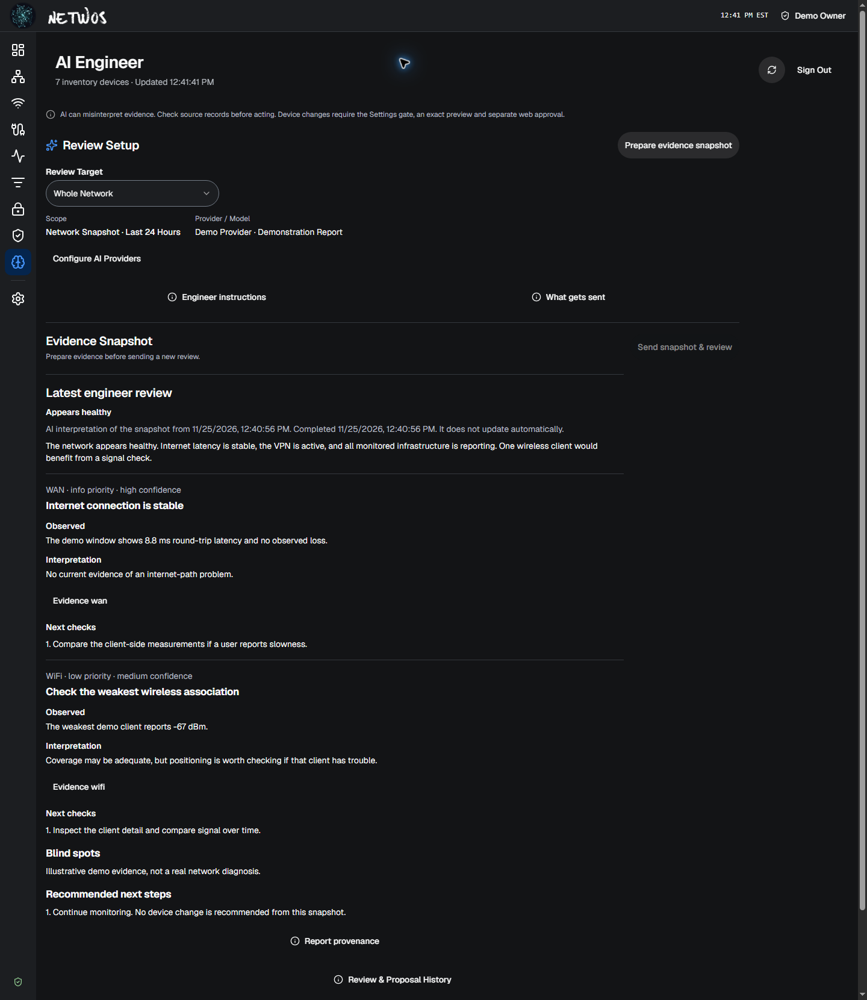

**The current preview does not execute AI-proposed device changes.** A connected executor is planned with an owner-enabled setting, exact change preview, recovery information and separate authenticated approval.

## Desktop detail. Phone access.

The responsive interface brings the same network observations to desktop and mobile, with compact navigation, bounded lists and focused information windows.

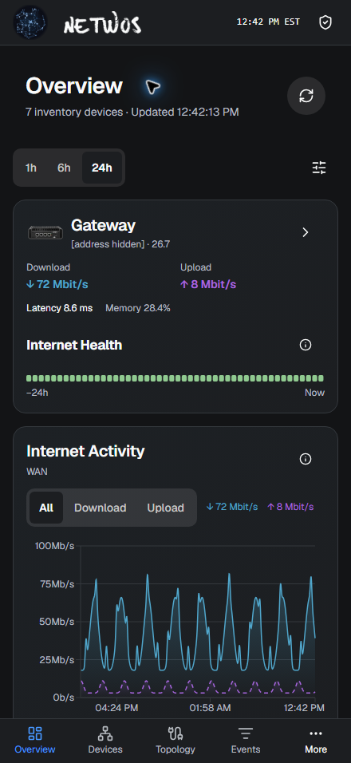
&nbsp;&nbsp;
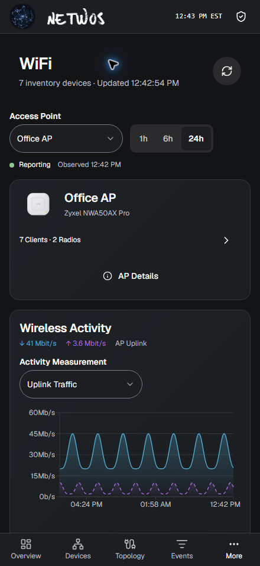

## Built for local networks

The current build includes OPNsense, supported OpenWrt AP telemetry, SODOLA status, 8311 ONU observations, computer-agent telemetry and profile-based SNMPv3 collection. Capabilities depend on the exact device, firmware and adapter. The GitHub-backed profile catalog supports validated syncing and a local cache.

Local accounts with authenticator setup and recovery, encrypted application backups, event history and administrative auditing are part of the workspace. Devices continue operating independently of the dashboard.

## Coming next

- **Controlled beta:** access is coordinated individually. This preview repository does not provide an application download or self-service enrollment.
- **Kiosk mode:** a focused display for a touchscreen, wall panel or always-on network station. Coming soon.
- **Approved device changes:** connected execution after adapter and recovery validation.

This repository contains preview media and this README only. Screenshots and animations show illustrative data, including the example AI report. They do not publish an operational network or demonstrate universal device compatibility.

## For your environment

NetwOS is being built for home labs and small businesses that want a self-hosted workspace across their chosen equipment. Custom integrations, additional data points and dashboards for specific operational metrics can be discussed.

**Interested in controlled beta access or a custom integration? Contact netwos[@]fmhmx.com.**
